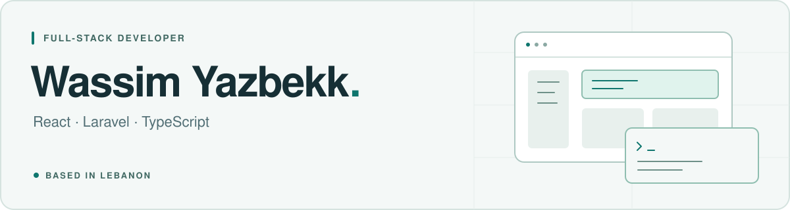

<picture>
  <source media="(prefers-color-scheme: dark)" srcset="assets/header-dark.svg">
  <source media="(prefers-color-scheme: light)" srcset="assets/header-light.svg">
  
</picture>

# Hi, I'm Wassim.

I'm a software developer from Lebanon, building web applications with **React** and **Laravel**. I enjoy working across the stack, from the interface to the API and database behind it.

[Portfolio](https://wassimyazbekk.github.io) · [LinkedIn](https://www.linkedin.com/in/wassim-yazbekk/) · [Email](mailto:wassimyazbekk.development@gmail.com)

## Selected work

| Project | What you'll find |
| :--- | :--- |
| **[shadcn Table Pagination](https://github.com/WassimYazbekk/shadcn-table-pagination)** | A reusable data table example with server-side pagination. React · TypeScript · shadcn/ui |
| **[Game of Life](https://github.com/WassimYazbekk/react-game-of-life)** | Conway's Game of Life, built in React. React · JavaScript |
| **[Express + MySQL API](https://github.com/WassimYazbekk/express-mysql-server)** | An API example with JWT authentication, authorization, and CRUD operations. Node.js · Express · MySQL |

## My toolkit

- **Frontend:** React, Next.js, TypeScript, JavaScript, Tailwind CSS
- **Backend & data:** Laravel, Node.js, Express, MySQL, Firebase
- **Tools:** Git, GitHub, Neovim

---

Fun fact: I once wanted to be a physicist.
